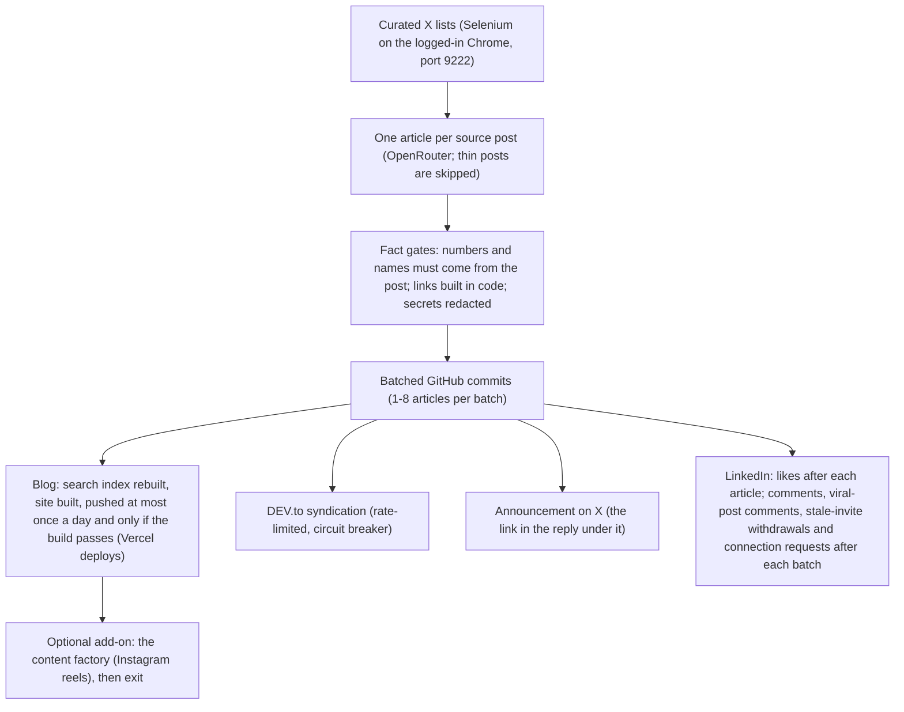

# AI Resources Pipeline


An autonomous curation and syndication pipeline. Each run reads curated X lists, turns the strongest posts into grounded technical articles, commits them to GitHub, publishes them on a Next.js knowledge hub ([blogs.drix10.com](https://blogs.drix10.com)) and DEV.to, announces them on X, and engages on LinkedIn with gated, genuine interactions.

One `npm start` is one full run, start to finish. There is no scheduler: run it again (or schedule it with your OS) for the next batch.

## How a run works



| | |
| --- | --- |
| 📰 **Grounded articles** | One article per source post, by `openai/gpt-oss-120b` (picked by benchmark: 9 models, 30 real posts). Every number and name must be in the post; links are built in code; thin posts are skipped, a rejected article gets one retry. |
| 🔍 **Search-first** | Titles open with the name a reader searches for; each digest's lead item becomes the page title, slug, DEV.to title and X announcement. DEV.to copies link back to the blog as canonical. |
| 🤝 **LinkedIn, gated** | Short peer comments checked by code gates and a critic (no critic, no comment). People who engaged with you come first; a viral pass comments on posts about to reach a large audience. Every LinkedIn step is non-fatal. |
| 🔒 **Safe** | Credentials, webhooks, keys and internal IPs are stripped before any commit. One run at a time (`.pipeline.lock`); Ctrl+C stops at the next step. |

LinkedIn's daily caps: 20 comments + 8 viral, 60 likes, 5 follows, 15 connection requests (90 a week; 3 a day while under 20% of the last month's invites were accepted), 10 withdrawals of invites pending 14+ days. With `LINKEDIN_TARGETED=true` engagement leans to people building with AI, with finance as the second audience; with `false` it works off your home feed (Top and Recent) and LinkedIn's People you may know.

## Requirements

- Node.js 20 or newer, and Git with push access to this repository (the run commits articles and pushes the blog).
- Google Chrome. The pipeline drives your logged-in Chrome over remote debugging on port 9222 (profile in `~/chrome-debug`); `npm start` launches it if it is not running. Log in to x.com and linkedin.com in that window once.
- A writer for articles and comments, chosen per job with `LLM_PROVIDER` (and `LLM_ARTICLE_PROVIDER`, `LLM_COMMENT_PROVIDER`, `LLM_VIRAL_PROVIDER`): an [OpenRouter](https://openrouter.ai) API key (the default, with NVIDIA NIM as its fallback), NVIDIA NIM, a local Ollama model, or a Claude subscription through the [Claude Code](https://docs.anthropic.com/en/docs/claude-code) CLI (`claude`, signed in once).
- A GitHub personal access token with `repo` scope (`GITHUB_PAT`) for the articles repository.

## Setup

```bash
git clone https://github.com/Drix10/ai-resources-pipeline.git
cd ai-resources-pipeline
npm install
npm --prefix blog install                     # the knowledge hub (built before every push)
cp .env.example .env                          # then fill in your keys (see Configuration)
cp config/creators.example.json config/creators.json   # optional: LinkedIn creators to engage with
npm test                                      # runs offline, against a temporary state folder
```

## Usage

```bash
npm start                    # one full run, then exit
npm run preview -- --max 3   # print the LinkedIn comments and likes a run would make, without posting
npm run preview -- --viral   # the same for the viral pass: big names and the day's most-engaged posts
npm run seo:audit -- <url>   # audit a deployed blog for SEO issues
```

## Configuration

Every setting is in [`.env.example`](.env.example) with a comment and a working default. The essentials:

| Variable | Purpose |
| --- | --- |
| `LLM_PROVIDER` | Who writes: `openrouter` (default), `nvidia`, `local` or `claude`; per-job overrides and the Claude models in `.env.example` |
| `OPENROUTER_API_KEY` | Article writing and comment drafting (provider `openrouter`) |
| `GITHUB_PAT`, `GITHUB_USERNAME`, `GITHUB_REPONAME` | The repository the articles are committed to |
| `TWITTER_POST` | Post the announcement on X (`true`/`false`) |
| `LINKEDIN_LIKE`, `LINKEDIN_FEED_REPLY`, `LINKEDIN_VIRAL`, `LINKEDIN_CONNECT`, `LINKEDIN_PROFILE_SLUG` | LinkedIn engagement switches and your profile (caps: `LINKEDIN_*_MAX_PER_DAY`, see `.env.example`) |
| `LINKEDIN_TARGETED` | `true`: target AI/finance (searches, big names, topic and US filters); `false`: home feed and People you may know only |
| `LINKEDIN_OWN_REPLIES` | On by default: reply to the comments on your own posts (start of each run and after each batch). Never twice, never where you already replied by hand; a comment only you can answer is logged for you, never guessed |
| `DEVTO_API_KEY`, `DEVTO_AUTO_PUBLISH` | DEV.to syndication |
| `NVIDIA_API_KEY` | NVIDIA NIM (provider `nvidia`, and the fallback for `openrouter` and `claude`) |
| `AUTHOR_NAME`, `AUTHOR_HANDLE`, `AUTHOR_EMAIL`, `AUTHOR_WEBSITE_URL` (and `AUTHOR_*_URL` links) | Your identity: commit author, article bylines and footers, the LinkedIn persona |
| `CANONICAL_BASE_URL` | The blog's public address (articles link to it; DEV.to syndication needs it) |
| `FACTORY_ENABLED`, `FACTORY_DIR` | The optional content factory (below) |

## Repository layout

```
index.js, start-app.js   entry points: one run; the Chrome check before it
config/                  settings (config/index.js) and the LinkedIn creators template
src/services/            cron.js (the run), twitter.js, llm.js, github.js, syndication.js, linkedin.js, feedEngage.js
src/utils/               helpers (logging, blog index), pageFetch, chromeLauncher, factory (the optional add-on)
blog/                    the Next.js 14 knowledge hub (content, search index, slides)
portfolio/               drix10.com: projects, open-source work and the contribution graph, read live from GitHub
scripts/                 feed-preview.js, seo-audit.mjs
tests/                   node:test suites (offline; tests/_env.js isolates state)
data/                    machine-local runtime state (gitignored)
```

## Deploying the sites

Both sites deploy on Vercel from this repository. Set `CANONICAL_BASE_URL` (blog) and `NEXT_PUBLIC_SITE_URL` (portfolio) to the exact public addresses, and `GITHUB_READ_TOKEN` on the portfolio. Optional: `NEXT_PUBLIC_PORTFOLIO_URL` (the blog's link to the portfolio), `NEXT_PUBLIC_BLOG_URL` (the portfolio's link to the blog), `GOOGLE_SITE_VERIFICATION`, `BING_SITE_VERIFICATION`. See [`blog/README.md`](blog/README.md).

## Optional: the content factory

The Instagram content factory (narrated reels built by a Claude Code agent) is a separate, private repository. Check it out at `./factory` (or point `FACTORY_DIR` at it) and set `FACTORY_ENABLED=true`: each run then ends with a factory pass. The factory reads its own `factory/.env`, or this repository's `.env` when it has none (its names are in `factory/.env.example`). Without it, the pipeline runs as usual and logs a warning if the factory was requested but is missing.

## Troubleshooting

- **"The pipeline is running" / lock held.** Another run is active, or one crashed: a lock whose process is gone is taken over automatically.
- **Chrome not reachable on 9222.** Close every Chrome window and run `npm start` again; it relaunches Chrome with remote debugging on your profile.
- **X shows a login wall.** Log in to x.com in the debugging Chrome window once; the session persists in its profile.
- **Articles stop with 401/402 from OpenRouter.** The key is invalid or out of credit; the run stops writing rather than publishing anything unchecked.
- **The blog is not pushed.** The site build failed; nothing is pushed until `npm --prefix blog run build` passes.

## License

[MIT](LICENSE)


<!-- drix10-footer -->
---

<div align="center">

**Built by [Drishtant Ghosh (Drix10)](https://drix10.com)** · AI systems engineer and 1x acquired founder, Bengaluru

[Portfolio](https://drix10.com) · [LinkedIn](https://www.linkedin.com/in/drix10) · [X](https://x.com/DrishtantGhosh) · [Blog](https://blogs.drix10.com) · [All projects](https://github.com/Drix10)

<sub>More from Drix10: [Agent Flow](https://github.com/Drix10/agent-flow) (guardrails for AI coding agents) · [MiroHedge](https://github.com/Drix10/hypothesis-arena) (AI-assisted systematic fund) · [Guardian](https://github.com/Drix10/guardian-gpt) (UPI scam interceptor) · [Sentinel](https://github.com/Drix10/sentinal) (AI security CLI) · [Keystroke-LLM](https://github.com/Drix10/keystroke-llm) (NumPy transformer on a keyboard) · [AI Resources](https://github.com/Drix10/ai-resources) (daily AI knowledge base)</sub>

</div>
