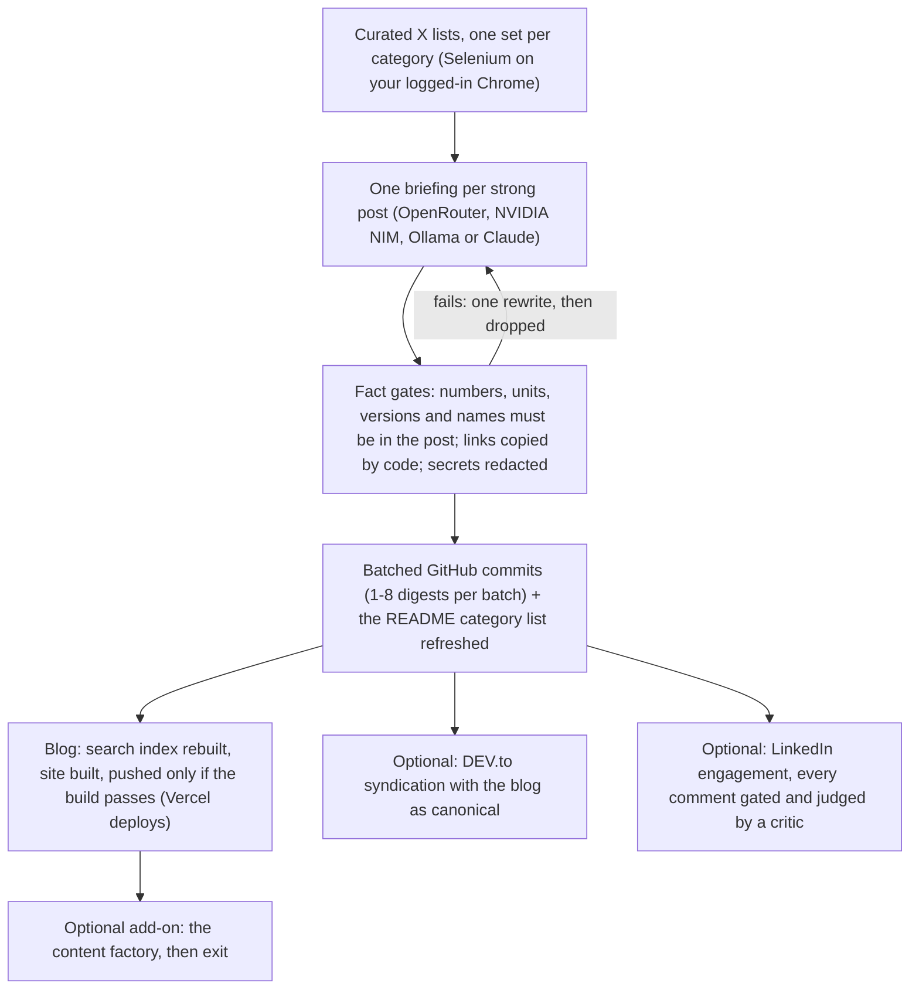

<h1 align="center">AI Resources Pipeline</h1>

<p align="center">
  <strong>The engine behind <a href="https://github.com/Drix10/ai-resources">AI Resources</a>: 100,000+ AI briefings, 10,900+ commits and a 2,000-article blog, written without a human in the loop.</strong><br/>
  It reads curated X lists, writes grounded technical briefings with an LLM, rejects any number, unit, model version or name that is not in the source, commits them to GitHub and ships a Next.js site with search, RSS, llms.txt and OG images. One <code>npm start</code> per run.
</p>

<p align="center">
  <a href="https://github.com/Drix10/ai-resources-pipeline/stargazers"></a>
  <a href="https://github.com/Drix10/ai-resources"></a>
  <a href="https://github.com/Drix10/ai-resources-pipeline/commits/main"></a>
  
  <a href="LICENSE"></a>
</p>

<p align="center">
  <a href="https://github.com/Drix10/ai-resources"><b>See the output</b></a> ·
  <a href="https://blogs.drix10.com"><b>Live blog</b></a> ·
  <a href="#setup"><b>Run your own</b></a> ·
  <a href="#how-a-run-works"><b>How a run works</b></a>
</p>

> ⭐ **If you build with LLMs and care about them not making things up, star the repo.** The fact gates in `src/services/llm.js` are the part worth stealing.

---

## What it has produced

The pipeline is not a demo. This is what it (and its earlier versions) has shipped so far, and every number can be checked in the repositories:

| | |
| ---: | --- |
| **100,000+** | briefings in [Drix10/ai-resources](https://github.com/Drix10/ai-resources), in 10,800+ digest files across 41 categories |
| **10,900+** | commits to that repository since November 2024 |
| **~2,000** | articles on [blogs.drix10.com](https://blogs.drix10.com), with client-side search, category pages, [RSS](https://blogs.drix10.com/rss.xml), [llms.txt](https://blogs.drix10.com/llms.txt), a sitemap and an OG image per article |
| **~$0.0001** | per briefing with the default writer, `openai/gpt-oss-120b` on OpenRouter |

## Why it is different from "LLM summarises tweets"

Most AI content bots paste a post into a model and publish whatever comes back. This one treats the model as an untrusted writer:

- **Grounding gates in code.** Every number must appear in the source post, with its own unit and currency (`$10 billion` is not the post's `$10 million`). Every versioned model name must match (`GPT-6` is not the post's `GPT-4`). Every capitalised name in the title, labels and prose must come from the post or its author's handles. A failed draft gets one rewrite with the exact problems listed, then it is dropped.
- **The model never writes a link.** Resource links are copied from the post by code (t.co links resolved to where they go), so they cannot be invented, duplicated or left empty.
- **Thin posts are skipped, not padded.** The writer scores each post's value; a post with nothing concrete is consumed without publishing.
- **Writer picked by benchmark.** 9 models, 30 real posts, judged for faithfulness, specificity and publishability. The winner, `openai/gpt-oss-120b`, is the default, with `qwen/qwen3.7-flash` as its fallback.
- **No hype words, no filler.** Banned vocabulary is rejected unless the source itself uses the word.
- **Safe to point at a public repo.** Credentials, webhooks, keys and internal IPs are redacted before any commit. Duplicates are caught across categories within a run.
- **Tested offline.** 17 `node:test` suites run without network or keys (`npm test`).

## How a run works



One `npm start` is one full run, start to finish. There is no scheduler: run it again, or schedule it with your OS, for the next batch. One run at a time (`.pipeline.lock`); Ctrl+C stops at the next step.

**Search-first titles.** Titles open with the name a reader searches for; each digest's lead item becomes the page title, slug and DEV.to title.

**LinkedIn, gated.** Short peer comments pass code gates and a separate critic (no critic, no comment). Daily caps: 20 comments + 8 viral, 60 likes, 5 follows, 15 connection requests (90 a week; 3 a day while under 20% of the last month's invites were accepted), 10 withdrawals of invites pending 14+ days. With `LINKEDIN_TARGETED=true` engagement leans to people building with AI, with finance second; with `false` it works off your home feed and People you may know. Every LinkedIn step is non-fatal.

## Requirements

- Node.js 20 or newer, and Git with push access to the articles repository and this one (the run commits articles and pushes the blog).
- Google Chrome. The pipeline drives your logged-in Chrome over remote debugging on port 9222 (profile in `~/chrome-debug`); `npm start` launches it if it is not running. Log in to x.com (and linkedin.com, for engagement) in that window once.
- A writer, chosen per job with `LLM_PROVIDER` (and `LLM_ARTICLE_PROVIDER`, `LLM_COMMENT_PROVIDER`, `LLM_VIRAL_PROVIDER`): an [OpenRouter](https://openrouter.ai) API key (the default, with NVIDIA NIM as its fallback), NVIDIA NIM, a local Ollama model, or a Claude subscription through the [Claude Code](https://docs.anthropic.com/en/docs/claude-code) CLI (`claude`, signed in once).
- A GitHub personal access token with `repo` scope (`GITHUB_PAT`) for the articles repository.

## Setup

```bash
git clone https://github.com/Drix10/ai-resources-pipeline.git
cd ai-resources-pipeline
npm install
npm --prefix blog install                     # the knowledge hub (built before every push)
cp .env.example .env                          # then fill in your keys (see Configuration)
cp config/creators.example.json config/creators.json   # optional: LinkedIn creators to engage with
npm test                                      # runs offline, against a temporary state folder
```

Point `GITHUB_USERNAME` / `GITHUB_REPONAME` at your own repository and edit the categories (`folders` in `config/index.js`) to run a knowledge base on your own lists.

## Usage

```bash
npm start                    # one full run, then exit
npm run preview -- --max 3   # print the LinkedIn comments and likes a run would make, without posting
npm run preview -- --viral   # the same for the viral pass: big names and the day's most-engaged posts
npm run seo:audit -- <url>   # audit a deployed blog for SEO issues
```

## Configuration

Every setting is in [`.env.example`](.env.example) with a comment and a working default. The essentials:

| Variable | Purpose |
| --- | --- |
| `LLM_PROVIDER` | Who writes: `openrouter` (default), `nvidia`, `local` or `claude`; per-job overrides and the Claude models in `.env.example` |
| `OPENROUTER_API_KEY` | Article writing and comment drafting (provider `openrouter`) |
| `GITHUB_PAT`, `GITHUB_USERNAME`, `GITHUB_REPONAME` | The repository the articles are committed to |
| `LINKEDIN_LIKE`, `LINKEDIN_FEED_REPLY`, `LINKEDIN_VIRAL`, `LINKEDIN_CONNECT`, `LINKEDIN_PROFILE_SLUG` | LinkedIn engagement switches and your profile (caps: `LINKEDIN_*_MAX_PER_DAY`, see `.env.example`) |
| `LINKEDIN_TARGETED` | `true`: target AI/finance (searches, big names, topic and US filters); `false`: home feed and People you may know only |
| `LINKEDIN_OWN_REPLIES` | On by default: reply to the comments on your own posts (start of each run and after each batch). Never twice, never where you already replied by hand; a comment only you can answer is logged for you, never guessed |
| `X_REPLIES` | On by default: after each batch, 2–3 replies under fresh X posts with real momentum (home For you + Following, a curated list), then 1–2 under posts going viral; gated and judged like the LinkedIn comments, never twice (`data/x-replies.json`). Caps: `X_REPLIES_MAX_PER_DAY` (20), `X_REPLIES_VIRAL_MAX_PER_DAY` (8); pass limit `X_PASS_TIMEOUT_MS` |
| `REDDIT_COMMENTS` | On by default: after each batch, at most one comment in a fresh Reddit thread (subs in `config/reddit.js`) from the account logged in to the debug Chrome; answers first, never a product mention, gated and judged like the X replies, never twice in a thread (`data/reddit-comments.json`). 20–40 min apart, one per sub a day, cap `REDDIT_COMMENTS_MAX_PER_DAY` (6); paused 24–48 h when Reddit refuses. Pain points the threads state go to `data/reddit-painpoints.jsonl` |
| `DEVTO_API_KEY`, `DEVTO_AUTO_PUBLISH` | DEV.to syndication |
| `NVIDIA_API_KEY` | NVIDIA NIM (provider `nvidia`, and the fallback for `openrouter` and `claude`) |
| `AUTHOR_NAME`, `AUTHOR_HANDLE`, `AUTHOR_EMAIL`, `AUTHOR_WEBSITE_URL` (and `AUTHOR_*_URL` links) | Your identity: commit author, article bylines and footers, the LinkedIn persona |
| `CANONICAL_BASE_URL` | The blog's public address (articles link to it; DEV.to syndication needs it) |
| `FACTORY_ENABLED`, `FACTORY_DIR` | The optional content factory (below) |

## Repository layout

```
index.js, start-app.js   entry points: one run; the Chrome check before it
config/                  settings (config/index.js) and the LinkedIn creators template
src/services/            cron.js (the run), twitter.js, llm.js (writer + fact gates), github.js, syndication.js, linkedin.js, feedEngage.js
src/utils/               helpers (logging, blog index), pageFetch, chromeLauncher, factory (the optional add-on)
blog/                    the Next.js 14 knowledge hub (content, search index, RSS, llms.txt, OG images)
portfolio/               drix10.com: projects, open-source work and the contribution graph, read live from GitHub
scripts/                 feed-preview.js, seo-audit.mjs
tests/                   node:test suites (offline; tests/_env.js isolates state)
data/                    machine-local runtime state (gitignored)
```

## Deploying the sites

Both sites deploy on Vercel from this repository. Set `CANONICAL_BASE_URL` (blog) and `NEXT_PUBLIC_SITE_URL` (portfolio) to the exact public addresses, and `GITHUB_READ_TOKEN` on the portfolio. Optional: `NEXT_PUBLIC_PORTFOLIO_URL` (the blog's link to the portfolio), `NEXT_PUBLIC_BLOG_URL` (the portfolio's link to the blog), `GOOGLE_SITE_VERIFICATION`, `BING_SITE_VERIFICATION`. See [`blog/README.md`](blog/README.md).

## Optional: the content factory

The Instagram content factory (narrated reels built by a Claude Code agent) is a separate, private repository. Check it out at `./factory` (or point `FACTORY_DIR` at it) and set `FACTORY_ENABLED=true`: each run then ends with a factory pass. The factory reads its own `factory/.env`, or this repository's `.env` when it has none (its names are in `factory/.env.example`). Without it, the pipeline runs as usual and logs a warning if the factory was requested but is missing.

## Troubleshooting

- **"The pipeline is running" / lock held.** Another run is active, or one crashed: a lock whose process is gone is taken over automatically.
- **Chrome not reachable on 9222.** Close every Chrome window and run `npm start` again; it relaunches Chrome with remote debugging on your profile.
- **X shows a login wall.** Log in to x.com in the debugging Chrome window once; the session persists in its profile.
- **Articles stop with 401/402 from OpenRouter.** The key is invalid or out of credit; the run stops writing rather than publishing anything unchecked.
- **The blog is not pushed.** The site build failed; nothing is pushed until `npm --prefix blog run build` passes.

## Star history

<a href="https://star-history.com/#Drix10/ai-resources-pipeline&Drix10/ai-resources&Date"></a>

## License

[MIT](LICENSE). The briefings it produced in [Drix10/ai-resources](https://github.com/Drix10/ai-resources) are CC BY 4.0.


<!-- drix10-footer -->
---

<div align="center">

**Built by [Drishtant Ghosh (Drix10)](https://drix10.com)** · AI systems engineer and 1x acquired founder, Bengaluru

[Portfolio](https://drix10.com) · [LinkedIn](https://www.linkedin.com/in/drix10) · [X](https://x.com/DrishtantGhosh) · [Blog](https://blogs.drix10.com) · [All projects](https://github.com/Drix10)

<sub>More from Drix10: [Agent Flow](https://github.com/Drix10/agent-flow) (guardrails for AI coding agents) · [MiroHedge](https://github.com/Drix10/hypothesis-arena) (AI-assisted systematic fund) · [Guardian](https://github.com/Drix10/guardian-gpt) (UPI scam interceptor) · [Sentinel](https://github.com/Drix10/sentinal) (AI security CLI) · [Keystroke-LLM](https://github.com/Drix10/keystroke-llm) (NumPy transformer on a keyboard) · [AI Resources](https://github.com/Drix10/ai-resources) (100,000+ fact-checked AI briefings)</sub>

</div>
